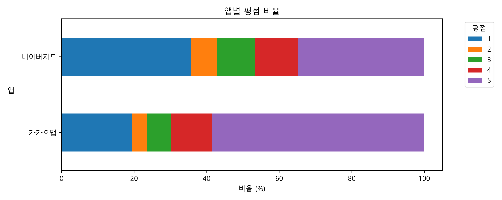
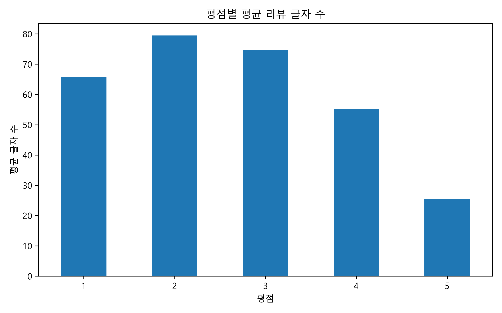
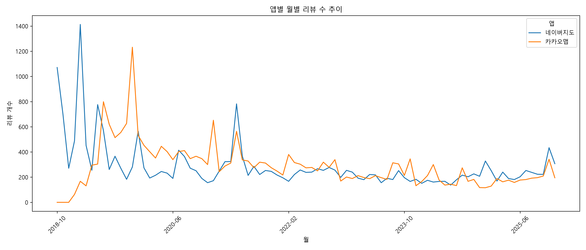
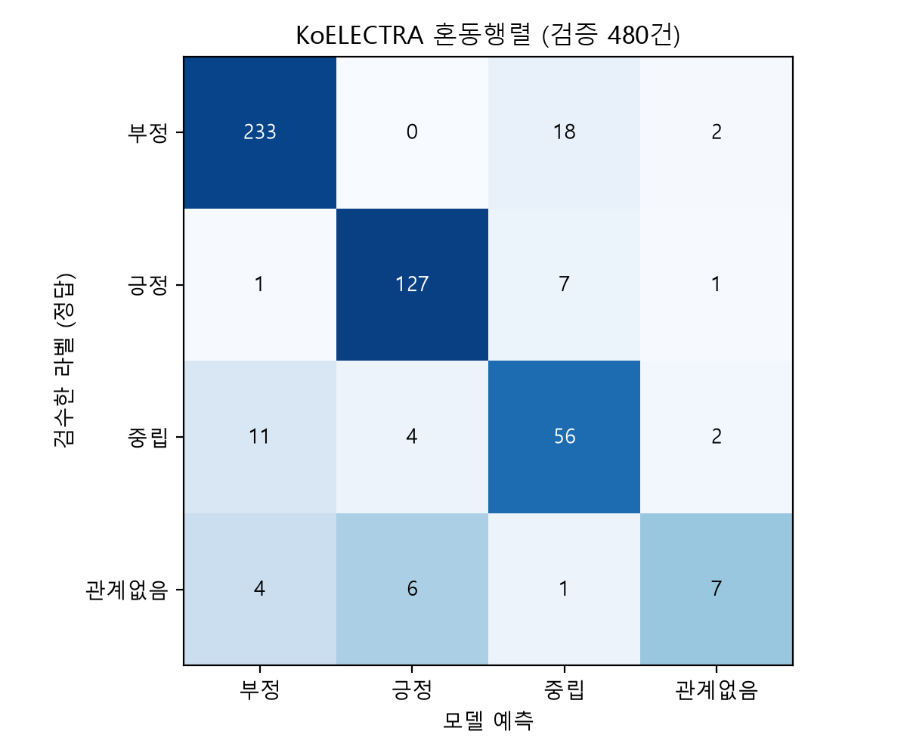
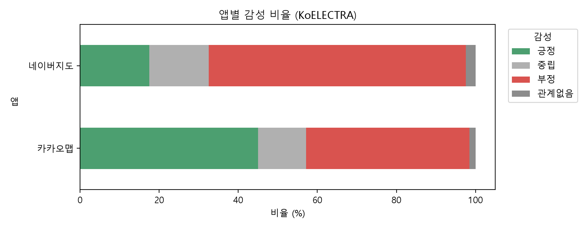
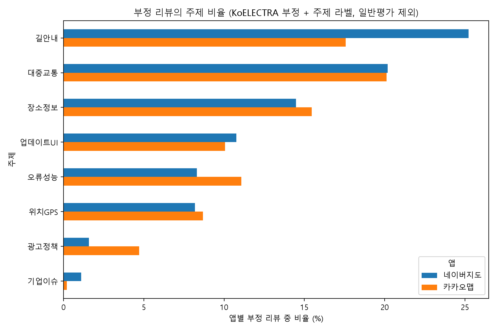
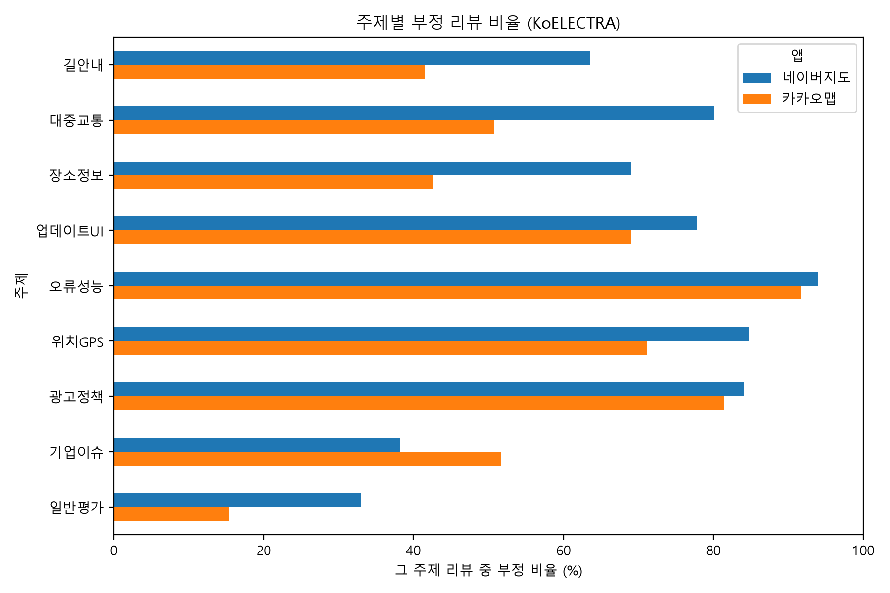
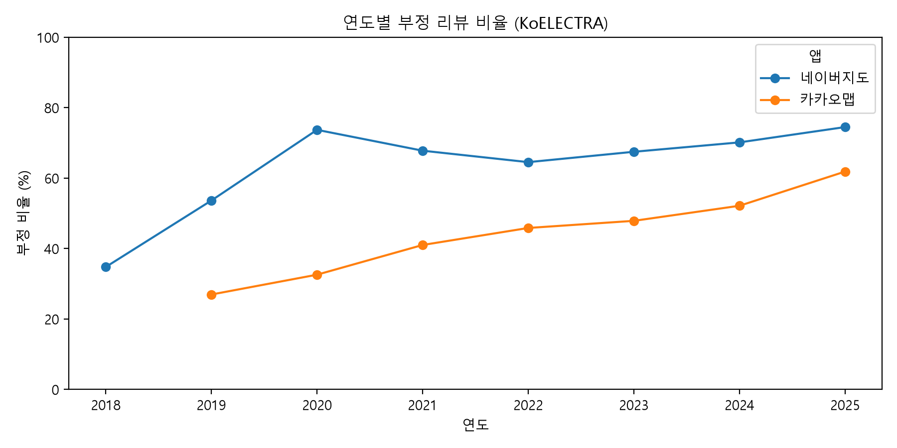
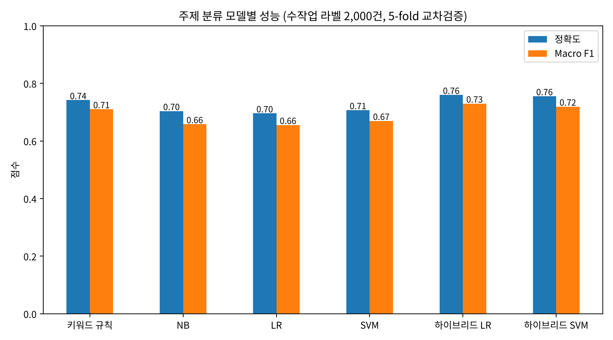
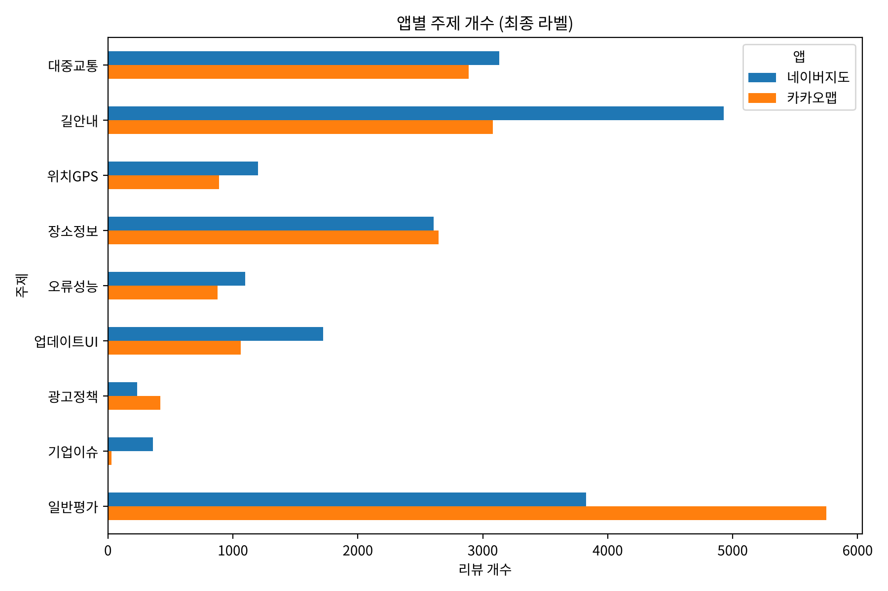

# 국내 지도 앱(카카오맵·네이버지도) 리뷰 감성 분석: KoELECTRA 문장 분류

## 1. 무엇을 알아보려고 하나

### 1.1 궁금한 점

우리나라에서 많이 쓰는 지도 앱은 **카카오맵**과 **네이버지도** 두 가지이다. 두 앱은 길찾기, 버스·지하철 안내, 가게 찾기 같은 기능이 거의 똑같다. 그런데 구글 플레이 스토어에 달린 리뷰의 평균 별점을 보면 **카카오맵은 3.85점, 네이버지도는 3.03점으로 0.82점이나 차이**가 난다.

별점은 만족도를 숫자 하나로만 보여 주기 때문에 다음과 같은 것은 알 수 없다.

- 사용자가 **어떤 기능 때문에** 불만인지
- 별점과 실제 리뷰 내용이 **다른 경우** (예: 별 5개를 주면서 불만을 적은 리뷰)
- 리뷰가 앱과 **아무 관계없는 내용**인지

그래서 이 프로젝트에서는 리뷰 문장을 읽고 **긍정 / 부정 / 중립 / 관계없음** 네 가지로 나누는 인공지능(KoELECTRA)을 학습시킨다. 그리고 이 결과를 리뷰가 어떤 기능(길안내, 버스·지하철 등)에 대한 것인지와 합쳐서 다음 질문에 답한다.

> **네이버지도는 왜 카카오맵보다 별점이 낮을까? 사용자는 어떤 기능에 불만이 있고, 그 불만은 해마다 어떻게 바뀌었을까?**

### 1.2 이야기의 흐름

```
① 두 앱의 별점 차이를 발견한다 (데이터 살펴보기)
→ ② 인공지능으로 리뷰 문장을 네 가지 감정으로 나눈다
→ ③ 불만 리뷰가 어떤 기능에 몰려 있는지 찾는다
→ ④ 해마다 어떻게 변했는지, 별점만 보면 놓치는 리뷰는 없는지 확인한다
→ ⑤ 각 앱이 무엇부터 고쳐야 하는지 제안한다
```

### 1.3 미리 세운 예상 (가설)

| 번호 | 예상 | 확인 방법 |
|---|---|---|
| H1 | 네이버지도에는 카카오맵보다 불만(부정) 리뷰가 더 많을 것이다. | 앱별 감정 비율 |
| H2 | 네이버지도의 불만은 **길안내**와 **업데이트로 바뀐 화면**에 더 많이 몰려 있을 것이다. | 불만 리뷰가 어떤 기능에 대한 것인지 |
| H3 | **버스·지하철 정보**에 대한 불만은 두 앱 모두에서 가장 많은 불만 중 하나일 것이다. | 불만 리뷰가 어떤 기능에 대한 것인지 |
| H4 | 어느 달에 리뷰가 갑자기 늘었다면, 앱 기능이 아니라 회사에 생긴 사건 때문일 수 있다. | 달마다 리뷰 수 변화 |
| H5 | 별점만으로는 리뷰의 감정을 정확히 알 수 없다. 별을 많이 주고도 불만을 적은 리뷰가 꽤 있을 것이다. | 별점별 감정 비율 |

---

## 2. 데이터를 모으고 다듬은 과정

```
리뷰 모으기 (50,000개) → 쓸 수 없는 리뷰 거르기 (36,750개 남음) → 데이터 살펴보기
   → 정답 붙이기: AI가 먼저 2,400개에 정답을 붙이고 → 직접 확인 → 2,399개 완성
   → 인공지능(KoELECTRA) 공부시키기 → 리뷰 36,750개 전부 분류 → 기능별로 묶어서 분석
```

### 2.1 리뷰 모으기

| 항목 | 내용 |
|---|---|
| 대상 앱 | 카카오맵, 네이버지도 |
| 모은 방법 | 구글 플레이 리뷰를 자동으로 가져오는 프로그램(`google-play-scraper`) 사용. 한국 스토어의 한국어 리뷰를 최신순으로 가져옴 (`test1.py`) |
| 기간 | 2018년 10월 ~ 2025년 12월 |
| 모은 리뷰 수 | **50,000개** (앱마다 25,000개) |
| 모은 정보 | 앱 이름, 리뷰 번호, 별점(1~5), 작성 날짜, 리뷰 내용, 좋아요 수, 앱 버전 |

처음에는 2024~2025년 리뷰만 모으려 했지만, 그 기간 리뷰는 9,659개뿐이라 과제 기준(5만 개)에 모자랐다. 그래서 2018년 리뷰부터 모아서 앱마다 25,000개를 채웠다.

> 원본 파일 이름(`map_app_reviews_2024_2025_50000.csv`)에는 "2024_2025"가 남아 있지만, 실제로는 위 표의 기간 동안 모은 리뷰이다.

### 2.2 쓸 수 없는 리뷰 거르기

| 단계 | 거르는 기준 | 남은 리뷰 수 |
|---|---|---|
| 원본 | 모은 리뷰 전체 (아직 아무것도 거르지 않음) | 50,000 |
| 중복 지우기 | 똑같은 리뷰가 두 번 들어 있으면 하나만 남김 (모을 때 이미 걸러서 지운 것은 0개) | 50,000 |
| 한글 리뷰만 | 글자의 절반 이상이 한글인 리뷰만 남김 (영어만 있거나 이모티콘만 있는 리뷰는 뺌) | 49,321 |
| 짧은 리뷰 빼기 | 10글자 이상인 리뷰만 남김 ("좋아요", "굿"처럼 내용이 거의 없는 리뷰는 뺌) | **36,750** |

거르고 남은 리뷰는 네이버지도 19,106개, 카카오맵 17,644개이다 (`labeling.py`).

---

## 3. 데이터 살펴보기

모은 리뷰 50,000개가 어떤 모습인지 그래프와 숫자로 살펴보았다 (`test.py`, 그래프 13개는 `eda_results/` 폴더).

### 3.1 한눈에 보는 숫자

| 앱 | 리뷰 수 | 평균 별점 | 리뷰 평균 길이 | 리뷰 길이 중간값 | 평균 좋아요 수 |
|---|---|---|---|---|---|
| 네이버지도 | 25,000 | **3.03** | 55.3자 | 33자 | 2.97 |
| 카카오맵 | 25,000 | **3.85** | 39.2자 | 19자 | 2.36 |

> **중간값**: 리뷰를 길이 순서로 줄 세웠을 때 딱 가운데에 있는 리뷰의 길이. 아주 긴 리뷰 몇 개 때문에 평균이 커지는 것을 피할 수 있다.

- 비어 있는 값은 앱 버전 4,579개뿐이다. 분석에 쓰는 별점과 리뷰 내용에는 빈 곳이 없다.

### 3.2 별점은 어떻게 나뉘어 있나

| 앱 | 1점 | 2점 | 3점 | 4점 | 5점 |
|---|---|---|---|---|---|
| 네이버지도 | 35.6% | 7.2% | 10.6% | 11.7% | 34.9% |
| 카카오맵 | 19.4% | 4.2% | 6.6% | 11.4% | 58.5% |



- 두 앱 모두 **1점과 5점에 몰려 있다.** 아주 만족하거나 아주 불만인 사람이 주로 리뷰를 쓰기 때문이다.
- 네이버지도는 1점(35.6%)이 5점(34.9%)보다 많고, 카카오맵은 5점이 절반이 넘는다(58.5%).

### 3.3 리뷰 길이

| 별점 | 1점 | 2점 | 3점 | 4점 | 5점 |
|---|---|---|---|---|---|
| 리뷰 평균 길이 | 65.7자 | 79.5자 | 74.7자 | 55.3자 | 25.4자 |



- 5점 리뷰는 평균 25자로 짧다("좋아요", "잘 쓰고 있어요"). 1~3점 리뷰는 65 ~ 80자로, 무엇이 불만인지 길게 적는다.
- 즉, **어떤 기능이 문제인지 알려 주는 정보는 대부분 별점이 낮은 리뷰에 들어 있다.** 그래서 이 프로젝트는 불만 리뷰를 자세히 들여다본다.

### 3.4 시기별 리뷰 수



- 2019년에 리뷰가 가장 많았고(앱마다 약 5,800개), 2020년부터는 앱마다 1년에 2,100~4,600개 정도이다.
- 네이버지도는 **2021년 5월에 리뷰가 782개로, 보통 달(238개)의 약 3배로 갑자기 늘었다.** 7절에서 리뷰 내용을 나눠 보니, 이 달 리뷰 649개(짧은 리뷰를 거른 뒤) 중 289개(44.5%)가 앱 기능이 아니라 **회사 직원의 직장 내 괴롭힘 사건**에 항의하거나 추모하는 글이었다(가설 H4).

---

## 4. 정답 붙이기 (라벨링)

인공지능을 공부시키려면 "이 리뷰는 부정이다"처럼 **정답이 붙은 예시**가 필요하다. 이 정답을 **라벨**이라고 하고, 정답을 붙이는 일을 **라벨링**이라고 한다.

### 4.1 네 가지 정답

리뷰의 **글만 보고**, 쓴 사람이 이 지도 앱을 어떻게 생각하는지 네 가지 중 하나를 고른다. 별점은 보지 않는다.

| 번호 | 정답 | 뜻 | 예시 |
|---|---|---|---|
| 0 | 부정 | 불만, 비난, 오류·불편 신고, "지운다/다른 앱으로 간다"는 말이 중심 | "버스 시간 하나도 안 맞음", "앱이 계속 튕겨요" |
| 1 | 긍정 | 만족, 칭찬, 추천, 고마움이 중심 | "길 안내가 정확해서 좋아요", "잘 쓰고 있습니다" |
| 2 | 중립 | 감정 없이 묻거나 기능을 부탁하는 글, 또는 칭찬과 불만이 비슷하게 섞인 글 | "다크모드 추가해 주세요", "즐겨찾기 폴더 순서를 바꿀 수 있나요?" |
| 3 | 관계없음 | 지도 앱과 상관없는 글 | 식당·병원 후기를 잘못 올린 글, 의미 없는 글자, 앱 이야기 없이 추모만 한 글 |

정답 번호는 수업 시간에 쓴 데이터(0 = 부정, 1 = 긍정)와 같은 뜻이 되도록 정했다.

**헷갈릴 때 정하는 규칙** (`sentiment/라벨링_가이드.md`)

1. **가장 중심이 되는 마음**으로 고른다. 칭찬이 분명하고 부탁이 붙어 있으면("잘 쓰고 있어요. 다크모드 부탁해요") 긍정, 불만이 분명하고 칭찬이 붙어 있으면("좋았는데 요즘 오류가 너무 많아요") 부정.
2. 칭찬과 불만이 비슷하게 섞여 있으면 중립.
3. 감정 없이 부탁이나 질문만 있으면 중립. 부탁에 짜증이 섞여 있으면("제발 좀 고쳐라") 부정.
4. 오류를 담담하게 알리는 글("검색이 안 됩니다")도 앱의 문제를 말하는 것이므로 부정.
5. 회사 사건 때문에 앱을 지우겠다고 하면 부정, 앱 이야기 없이 추모만 하면 관계없음.
6. 비꼬는 말("참 잘~ 하네요 ㅋㅋ 덕분에 길 잃음")은 진짜 뜻(대부분 부정)으로 판단.

### 4.2 정답을 붙인 순서

| 단계 | 한 일 | 개수 |
|---|---|---|
| ① 리뷰 고르기 | 거르고 남은 리뷰에서 앱마다 1,200개를 무작위로 뽑음 | 2,400 |
| ② AI가 먼저 정답 붙이기 | 4.1절 규칙을 AI(Claude)에게 주고, 리뷰를 하나씩 읽고 판단하게 함 (특정 단어만 찾아서 정하는 방식은 쓰지 않음) | 2,400 |
| ③ 정답이 믿을 만한지 확인 | 다른 AI에게 같은 규칙으로 300개를 따로 맡겨서, 두 결과가 얼마나 같은지 비교 | 300 |
| ④ 직접 확인 | 엑셀 파일(`sentiment/감성라벨링_검수.xlsx`)에서 전체를 직접 확인. AI가 틀렸을 가능성이 높은 231개(별점과 반대인 정답, 두 AI의 의견이 다른 리뷰, 관계없음)는 따로 표시해서 먼저 확인 | 2,400 |
| ⑤ 공부용 파일 만들기 | 확인을 마친 리뷰만 수업 코드가 읽을 수 있는 모양으로 바꿈 (`sentiment/make_koelectra_data.py`) | **2,399** |

**두 AI가 얼마나 같은 답을 냈나 (③)**

| 지표 | 값 | 뜻 |
|---|---|---|
| 같은 답의 비율 | **96.7%** | 300개 중 290개의 정답이 같았다 |
| 카파 점수 | **0.945** | 우연히 같은 답이 나온 경우를 빼고 계산한 점수. 1에 가까울수록 좋고, 0.8을 넘으면 "거의 완벽하게 같다"고 본다 |

답이 달랐던 10개 중 6개는 "부정이냐 중립이냐"로 갈렸는데, 불만과 부탁이 함께 들어 있는 리뷰였다. 이 정도면 네 가지 정답의 뜻이 누가 붙여도 거의 같은 결과가 나올 만큼 분명하다고 판단했다.

**직접 확인 (④)**

확인하면서 1개("버스 점검을 너무 자주, 오래해서 불편해요 무슨 점검하는건지 여쭤봐도 될까요?")를 공부용 데이터에서 뺐다. 그래서 최종 공부용 데이터는 **2,399개**가 되었다.

### 4.3 완성된 공부용 데이터

파일: `map_reviews_train.txt` (수업 데이터 `ratings_train2.txt`와 같은 모양)

| 칸 | 내용 |
|---|---|
| `id` | 엑셀 파일의 번호 |
| `document` | 리뷰 문장 |
| `label` | 정답 번호 (0 부정, 1 긍정, 2 중립, 3 관계없음) |

| 정답 | 개수 | 비율 |
|---|---|---|
| 0 부정 | 1,288 | 53.7% |
| 1 긍정 | 736 | 30.7% |
| 2 중립 | 304 | 12.7% |
| 3 관계없음 | 71 | 3.0% |
| **합계** | **2,399** | 100% |

**별점과 정답을 비교해 보면** (AI가 먼저 붙인 정답 기준)

| 정답 | 1점 | 2점 | 3점 | 4점 | 5점 |
|---|---|---|---|---|---|
| 부정 | 805 | 158 | 178 | 82 | 66 |
| 긍정 | 4 | 1 | 8 | 107 | 616 |
| 중립 | 23 | 9 | 61 | 94 | 117 |
| 관계없음 | 24 | 0 | 5 | 11 | 31 |

- 4~5점 리뷰 1,124개 중 148개(13.2%)는 내용이 불만이었다. 별을 많이 주면서도 오류나 불편을 알리는 리뷰가 꽤 있다.
- 중립 304개 중 211개가 4~5점이다. 칭찬 없이 "이 기능 넣어 주세요"라고 부탁만 하면서 별을 많이 준 경우이다.
- 별점을 그대로 정답으로 쓰면 이런 리뷰를 모두 틀리게 분류하게 된다. 그래서 **리뷰 글을 직접 읽고 정답을 붙인 것이 이 프로젝트에서 가장 중요한 작업**이다.

---

## 5. 인공지능(KoELECTRA) 공부시키기

> **KoELECTRA란?** 한국어 문장을 아주 많이 읽고 미리 공부해 둔 인공지능이다. 이미 한국어를 잘 이해하므로, 우리가 만든 2,399개의 예시만 더 보여 주면 "이 리뷰는 부정" 같은 판단을 배울 수 있다.

### 5.1 사용한 코드와 설정

수업 시간에 만든 KoELECTRA 코드(`KOELECTRA_Finetune.py`)를 그대로 썼다. 교수님께 확인을 받고 아래 세 줄만 바꾼 복사본(`KOELECTRA_Finetune_map.py`)으로 공부시켰다.

| 줄 | 수업 코드 | 바꾼 값 | 이유 |
|---|---|---|---|
| 20 | `train_data_path = "ratings_train2.txt"` | `"map_reviews_train.txt"` | 우리가 만든 공부용 데이터를 읽도록 |
| 70 | `num_labels=2` | `num_labels=4` | 정답이 2가지가 아니라 4가지라서 |
| 139 | `save_path = "koelectra-base-movie"` | `"koelectra-base-map"` | 수업 때 만든 모델을 덮어쓰지 않도록 |

| 항목 | 값 | 쉽게 말하면 |
|---|---|---|
| 미리 공부한 모델 | `koelectra_base_v3-discriminator` | 한국어를 미리 공부한 KoELECTRA |
| 문장 최대 길이 | 256 토큰 | 문장을 낱말 조각으로 잘랐을 때 256조각까지만 읽음 |
| 공부용 / 시험용 | 80% (1,919개) / 20% (480개) | 1,919개로 공부하고, 처음 보는 480개로 시험 |
| 한 번에 보는 양 | 32개 | 리뷰 32개를 묶어서 보고 조금씩 고침 |
| 고치는 정도 | 0.0001 | 한 번에 아주 조금씩 고쳐야 공부가 안정적임 |
| 반복 횟수 (에폭) | 4번 | 공부용 데이터 전체를 4번 되풀이해서 읽음 |
| 사용 장치 | 그래픽카드(GPU) | 계산이 빨라짐 |

### 5.2 공부 결과

| 반복 | 틀린 정도 (손실) | 공부한 문제 정확도 | 처음 보는 문제 정확도 |
|---|---|---|---|
| 1번째 | 0.6962 | 85.9% | 80.6% |
| 2번째 | 0.3744 | 93.5% | 86.5% |
| 3번째 | 0.1998 | 97.2% | 86.3% |
| 4번째 | 0.0990 | 99.1% | **88.1%** |

- 처음 보는 리뷰 480개에서 **88.1%를 맞혔다.** 모든 리뷰를 그냥 "부정"이라고 찍으면 53.7%쯤 맞으니, 그보다 약 34%p 더 잘 맞힌다.
- 공부한 문제는 99.1% 맞히는데 처음 보는 문제는 88.1%로, 11%p 차이가 난다. 원리를 배우기보다 **문제를 외워 버린 부분이 조금 있다**는 뜻이다(이를 **과적합**이라고 한다). 2번째 반복부터는 처음 보는 문제 점수가 86~88%에서 크게 오르지 않아서, 공부용 데이터가 2,399개로 많지 않은 것이 한계로 보인다.

### 5.3 정답별로 얼마나 잘 맞혔나

수업 코드는 전체 정확도만 알려 주므로, 공부를 마친 모델을 불러와 **같은 시험 문제 480개**로 정답별 점수를 따로 계산했다 (`KOELECTRA_analysis_map.py`).

| 정답 | 정밀도 | 재현율 | F1 점수 | 시험 문제 수 |
|---|---|---|---|---|
| 부정 | 0.936 | 0.921 | **0.928** | 253 |
| 긍정 | 0.927 | 0.934 | **0.930** | 136 |
| 중립 | 0.683 | 0.767 | 0.723 | 73 |
| 관계없음 | 0.583 | 0.389 | 0.467 | 18 |
| 평균 (네 정답을 똑같이 취급) | 0.782 | 0.753 | 0.762 | 480 |
| 평균 (문제 수만큼 취급) | 0.882 | 0.881 | 0.880 | 480 |

> **정밀도**: 모델이 "부정"이라고 한 것 중 진짜 부정인 비율. (헛짚지 않았나?)
> **재현율**: 진짜 부정인 것 중 모델이 찾아낸 비율. (빠뜨리지 않았나?)
> **F1 점수**: 정밀도와 재현율을 함께 본 점수. 1에 가까울수록 좋다.



> **그림 읽는 법**: 왼쪽은 진짜 정답, 아래쪽은 모델이 고른 답이다. 왼쪽 위에서 오른쪽 아래로 이어지는 칸이 맞힌 개수이고, 나머지 칸은 틀린 개수이다.

- **긍정과 부정은 F1 점수 0.93으로 매우 잘 맞힌다.** 긍정을 부정으로, 부정을 긍정으로 헷갈린 것은 480개 중 1개뿐이다.
- **중립(0.72)** 은 부정과 가장 많이 헷갈렸다(부정을 중립으로 18개, 중립을 부정으로 11개). 불만과 부탁이 섞인 리뷰는 두 AI도 의견이 갈렸던 종류이다(4.2절).
- **관계없음(0.47)** 은 18개 중 7개만 찾아냈다. 공부용 데이터에 71개(3%)밖에 없어서 충분히 배우지 못했다. 관계없음 예시를 더 모으면 나아질 수 있다(8절).

---

## 6. 결과: 궁금한 점에 대한 답

공부를 마친 모델로 거르고 남은 리뷰 **36,750개 전부**의 감정을 나누었다. 직접 확인한 2,399개는 확인한 정답을 쓰고, 나머지 34,351개는 모델이 고른 답을 썼다 (`dataset/sentiment_predictions.csv`). 리뷰가 어떤 기능에 대한 것인지는 7절의 결과를 썼다.

### 6.1 앱별 감정 비율 (H1)

| 앱 | 긍정 | 중립 | 부정 | 관계없음 | 리뷰 수 |
|---|---|---|---|---|---|
| 네이버지도 | 17.5% | 15.0% | **65.0%** | 2.4% | 19,106 |
| 카카오맵 | **45.0%** | 12.2% | 41.3% | 1.5% | 17,644 |



네이버지도 리뷰는 **10개 중 6~7개(65.0%)가 불만**이다. 카카오맵(41.3%)보다 23.7%p 많다. 칭찬 리뷰는 카카오맵이 약 2.6배 많다. **→ H1 예상이 맞았다.**

### 6.2 불만은 어떤 기능에 몰려 있나 (H2, H3)

**불만 리뷰를 기능별로 나누면** (불만 리뷰 전체를 100%로 볼 때)

| 기능 | 네이버지도 | 카카오맵 |
|---|---|---|
| 길안내 | **25.2%** | 17.6% |
| 버스·지하철 | **20.2%** | **20.1%** |
| 장소 정보 | 14.5% | 15.5% |
| 앱 오류·느림 | 8.3% | 11.1% |
| 업데이트·화면 | 10.8% | 10.1% |
| 위치·GPS | 8.2% | 8.7% |
| 광고·로그인·개인정보 | 1.6% | 4.7% |
| 회사 사건 | 1.1% | 0.2% |
| 기능 언급 없음 | 10.2% | 12.1% |



- 네이버지도의 불만은 **길안내(25.2%)** 에 가장 많이 몰려 있고, 카카오맵(17.6%)보다 7.6%p 많다.
- **버스·지하철**은 두 앱 모두 불만의 약 20%로, 길안내와 함께 가장 큰 불만이다. **→ H3 예상이 맞았다.**
- 업데이트·화면에 대한 불만은 두 앱이 비슷하다(10.8%, 10.1%). **→ H2는 길안내만 맞았다(일부만 맞음).**

**같은 기능 이야기 중 불만의 비율** (그 기능을 이야기한 리뷰 중 불만이 몇 %인가)

| 기능 | 네이버지도 | 카카오맵 | 차이 |
|---|---|---|---|
| 버스·지하철 | **80.1%** | 50.8% | **29.3%p** |
| 장소 정보 | 69.0% | 42.5% | 26.5%p |
| 길안내 | 63.6% | 41.6% | 22.0%p |
| 위치·GPS | 84.8% | 71.2% | 13.6%p |
| 업데이트·화면 | 77.7% | 69.0% | 8.7%p |
| 앱 오류·느림 | 93.9% | 91.7% | 2.2%p |
| 광고·로그인·개인정보 | 84.1% | 81.5% | 2.6%p |



같은 기능을 이야기해도 네이버지도 사용자가 훨씬 불만이 많다. 특히 **버스·지하철 이야기는 네이버지도에서 10개 중 8개가 불만**인데, 카카오맵은 절반 정도이다. 반대로 앱 오류나 광고 이야기는 두 앱 모두 대부분 불만이라 차이가 거의 없다.

즉, 두 앱의 별점 차이는 앱이 고장 나서라기보다 **사람들이 가장 자주 쓰는 기능(버스·지하철, 장소 찾기, 길안내)에 대한 만족도 차이** 때문이다.

### 6.3 해마다 어떻게 변했나

| 연도 | 2018 | 2019 | 2020 | 2021 | 2022 | 2023 | 2024 | 2025 |
|---|---|---|---|---|---|---|---|---|
| 네이버지도 불만 비율 | 34.7% | 53.6% | 73.7% | 67.8% | 64.5% | 67.5% | 70.1% | **74.5%** |
| 카카오맵 불만 비율 | - | 26.9% | 32.5% | 41.0% | 45.8% | 47.8% | 52.1% | **61.8%** |



- 네이버지도는 2020년부터 해마다 불만 비율이 65~75%로 계속 높다.
- **카카오맵은 2019년 26.9%에서 2025년 61.8%로 해마다 올랐다.** 두 앱의 차이도 2019년 26.7%p에서 2025년 12.7%p로 줄었다. 평균 별점으로는 카카오맵이 앞서지만, 최근 리뷰만 보면 카카오맵 사용자의 만족도도 빠르게 떨어지고 있다.
- 2021년 5월 네이버지도 리뷰가 갑자기 늘어난 것은 회사 사건에 대한 리뷰가 몰렸기 때문이다(3.4절). **→ H4 예상이 맞았다.**

### 6.4 별점만 보면 놓치는 리뷰 (H5)

| 별점 | 긍정 | 중립 | 부정 | 관계없음 |
|---|---|---|---|---|
| 1점 | 163 | 589 | 11,677 | 284 |
| 2점 | 30 | 289 | 2,354 | 23 |
| 3점 | 146 | 890 | 2,876 | 47 |
| 4점 | 1,291 | 1,532 | 1,488 | 76 |
| 5점 | 9,650 | 1,724 | 1,313 | 308 |

- **별 4~5개 리뷰 17,382개 중 2,801개(16.1%)는 내용이 불만이었다.** 예: "자꾸만 다른곳으로 안내하고 있어 택시하는 저로써는 난감할때가 많습니다"(별 5개)
- 별 4~5개 중 3,256개는 중립(주로 "이 기능 넣어 주세요" 같은 부탁)이었다.
- 별점만 보면 이런 불만과 부탁을 모두 "만족"으로 세게 된다. **→ H5 예상이 맞았다.**
- 반대로 별 1~2개인데 긍정으로 나온 193개 중에는 "개인정보유출되는 아주 훌륭한앱. 정보공개하시면 바로 개인정보유출됩니다^^"처럼 **비꼬는 말을 모델이 칭찬으로 잘못 읽은 경우**도 섞여 있다(8절).

### 6.5 정리

| 예상 | 결과 | 근거 |
|---|---|---|
| H1 네이버지도에 불만 리뷰가 더 많다 | **맞음** | 불만 65.0% vs 41.3% |
| H2 네이버지도는 길안내·업데이트 화면 불만이 더 많다 | **일부만 맞음** | 길안내 25.2% vs 17.6%, 업데이트·화면은 비슷(10.8% vs 10.1%) |
| H3 버스·지하철은 두 앱 공통의 큰 불만 | **맞음** | 두 앱 모두 불만의 약 20% |
| H4 리뷰가 갑자기 늘어난 건 회사 사건 때문일 수 있다 | **맞음** | 2021년 5월 네이버지도 리뷰의 44.5%가 회사 사건 이야기 |
| H5 별점만으로는 감정을 알 수 없다 | **맞음** | 별 4~5개 리뷰의 16.1%가 불만 |

**결론과 제안**

1. **네이버지도의 별점이 낮은 이유는 버스·지하철, 장소 찾기, 길안내 같은 핵심 기능에 대한 불만 때문이다.** 특히 버스·지하철 리뷰의 80%가 불만이므로, 버스·지하철 도착 시간을 정확하게 알려 주는 것을 가장 먼저 고쳐야 한다.
2. **카카오맵은 아직 별점이 높지만 불만 비율이 해마다 오르고 있다**(2019년 26.9% → 2025년 61.8%). 평균 별점에 가려진 최근의 만족도 하락을 눈여겨봐야 한다.
3. **별점 대신 리뷰 글을 읽고 나누면** 별을 많이 주고도 남긴 불만(16.1%)과 기능 부탁을 찾아낼 수 있다. 공부시킨 KoELECTRA는 새 리뷰가 올라올 때마다 자동으로 분류할 수 있어서, 앱 회사가 사용자의 불만을 빨리 알아차리는 데 도움이 된다.

---

## 7. 함께 쓴 분석: 리뷰가 어떤 기능에 대한 것인가

6절에서 "불만이 어떤 기능에 대한 것인가"를 보려고, 감정과는 따로 리뷰가 이야기하는 **기능(주제)** 을 9가지로 나누었다.

| 주제 | 뜻 | 예시 리뷰 |
|---|---|---|
| 대중교통 (버스·지하철) | 버스·지하철 도착 정보, 노선, 갈아타기, 내릴 곳 알림 | "버스 시간 하나도 안 맞음" |
| 길안내 | 자동차·걷기·자전거 길 안내, 내비게이션 | "멀쩡한 길 두고 이상한 길로 안내함" |
| 위치GPS | 내 위치, GPS, 방향 | "터널에서 GPS가 끊어져요" |
| 장소정보 | 장소 검색, 가게 정보, 즐겨찾기, 거리 사진(로드뷰), 지도가 최신인지 | "폐업한 식당이 아직도 나와요" |
| 오류성능 (앱 오류·느림) | 앱이 꺼지거나 멈추거나 느린 문제 | "앱이 계속 강제 종료됨" |
| 업데이트UI (업데이트·화면) | 업데이트로 바뀐 화면·디자인·사용 방법 | "업데이트 이후 너무 불편해졌어요" |
| 광고정책 | 광고, 로그인, 개인정보, 권한 요구 | "앱 실행할 때마다 광고가 떠요" |
| 기업이슈 (회사 사건) | 앱 기능과 상관없는 회사 사건에 대한 의견 | "삼가 고인의 명복을 빕니다" |
| 일반평가 (기능 언급 없음) | 특정 기능 없이 좋다/싫다만 말함 | "잘 쓰고 있습니다", "최고에요" |

**주제를 나눈 순서**

| 단계 | 한 일 | 결과 |
|---|---|---|
| ① 단어로 나누기 | 불만 리뷰에 자주 나온 단어(버스, 업데이트, 길찾기 등)로 주제별 단어 목록을 만들어 1차로 나눔 (`topic_keywords.py`, `labeling.py`) | 처음 보는 리뷰에서 71.0% 맞힘 |
| ② 정답 2,000개 만들기 | 규칙에 따라 AI(Claude)가 리뷰를 하나씩 읽고 주제를 정함. 같은 200개를 두 AI에게 따로 맡겨 비교 | 같은 답 90.0%, 카파 점수 0.879 |
| ③ 분류 프로그램 만들기 | 2,000개로 주제를 맞히는 프로그램을 공부시키고, 공부에 안 쓴 문제로 시험 (`topic_model.py`) | 76.0% 맞힘 (단어로만 나눌 때 74.2%) |
| ④ 전체 나누기 | 완성된 프로그램으로 36,750개 리뷰의 주제를 나눔 (`dataset/labeled_reviews_final.csv`) | 아래 표 |



| 주제 | 네이버지도 | 카카오맵 | 합계 |
|---|---|---|---|
| 길안내 | 4,928 | 3,080 | 8,008 |
| 대중교통 | 3,132 | 2,887 | 6,019 |
| 장소정보 | 2,607 | 2,648 | 5,255 |
| 업데이트UI | 1,721 | 1,062 | 2,783 |
| 위치GPS | 1,200 | 888 | 2,088 |
| 오류성능 | 1,099 | 879 | 1,978 |
| 광고정책 | 233 | 421 | 654 |
| 기업이슈 | 359 | 29 | 388 |
| 일반평가 | 3,827 | 5,750 | 9,577 |
| **합계** | **19,106** | **17,644** | **36,750** |



주제 분류는 76% 정도 맞히므로, 6.2절의 기능별 비율은 "대략 이런 경향"으로 읽어야 한다. 그래도 두 앱에 똑같은 프로그램을 썼기 때문에, 두 앱을 서로 비교하는 데에는 의미가 있다.

---

## 8. 아쉬운 점과 앞으로 할 일

- **관계없음 예시가 너무 적다.** 공부용 데이터의 3%(71개)뿐이라 점수가 0.47에 그쳤다. 식당 후기나 의미 없는 글자 같은 리뷰를 더 모아서 정답을 붙이면 나아질 것이다.
- **문제를 외운 부분이 있다(과적합).** 공부한 문제는 99.1%, 처음 보는 문제는 88.1%를 맞혔다. 공부용 데이터를 늘리면 차이를 줄일 수 있다.
- **비꼬는 말에 약하다.** "아주 훌륭한 앱^^"처럼 반대로 말하는 표현을 칭찬으로 잘못 읽을 때가 있다.
- **시험 방법.** 수업 코드대로 공부용 80%, 시험용 20%로만 나눴다. 공부에 전혀 쓰지 않은 별도의 마지막 시험 문제로는 확인하지 않았다.
- **기간이 길다.** 2018~2025년 리뷰를 모았기 때문에, 앱이 크게 바뀌기 전과 후의 리뷰가 섞여 있다.
- **AI가 먼저 정답을 붙였다.** 규칙을 정하고, 두 AI의 답이 96.7% 같은지 확인하고, 직접 확인도 했지만, 사람이 처음부터 붙인 정답과는 다를 수 있다.

---

## 9. 파일 구성과 실행 방법

| 파일 | 하는 일 |
|---|---|
| `test1.py` | 구글 플레이 리뷰 모으기 (앱마다 25,000개) → `map_app_reviews_2024_2025_50000.csv` |
| `test.py` | 모은 데이터 살펴보기 → `eda_results/` 그래프 13개, `앱별_통계요약.csv` |
| `labeling.py` | 쓸 수 없는 리뷰 거르기, 단어로 주제 나누기 → `dataset/labeled_reviews.csv` |
| `topic_keywords.py` | 주제별 단어 목록 |
| `label_check.py` | 주제 정답 확인, 두 AI의 답 비교 |
| `topic_model.py` | 주제 분류 프로그램 만들기 → `dataset/labeled_reviews_final.csv`, `models/topic_model.joblib` |
| `predict_topic.py` | 새 리뷰의 주제 맞히기 |
| `sentiment/감성라벨링_검수.xlsx` | 감정 정답을 직접 확인한 엑셀 파일 |
| `sentiment/라벨링_가이드.md` | 감정 정답을 붙이는 규칙 |
| `sentiment/ai_labels_2400.csv` | AI가 먼저 붙인 감정 정답 |
| `sentiment/label_agreement_sentiment.csv` | 두 AI의 답을 비교한 300개 |
| `sentiment/make_koelectra_data.py` | 엑셀 파일 → 수업 코드용 공부 데이터 `map_reviews_train.txt` |
| `koelectra/KOELECTRA_Finetune_map.py` | 수업 KoELECTRA 코드 (3줄만 바꿈). KoELECTRA 프로젝트 폴더에서 실행한 코드의 사본 |
| `koelectra/KOELECTRA_analysis_map.py` | 정답별 점수 계산, 리뷰 전체 분류, 결과 분석 → `koelectra_results/`, `dataset/sentiment_predictions.csv`. KoELECTRA 프로젝트 폴더에서 실행한 코드의 사본 |

실행 순서

```bash
python test1.py                          # 1. 리뷰 모으기
python test.py                           # 2. 데이터 살펴보기
python labeling.py                       # 3. 리뷰 거르기 + 단어로 주제 나누기
python topic_model.py                    # 4. 주제 분류 프로그램 → 전체 주제 나누기
# 5. sentiment/감성라벨링_검수.xlsx 에서 정답 직접 확인
python sentiment/make_koelectra_data.py  # 6. 공부용 데이터 만들기
# 아래 두 파일은 KoELECTRA 프로젝트 폴더(미리 공부한 모델과 공부용 데이터가 있는 곳)에서 실행
python KOELECTRA_Finetune_map.py         # 7. KoELECTRA 공부시키기 (그래픽카드 환경)
python KOELECTRA_analysis_map.py         # 8. 점수 확인 + 전체 분석
```

KoELECTRA를 공부시키고 분석하려면 `torch`, `transformers`가 설치되어 있어야 한다. 미리 공부한 모델(`koelectra_base_v3-discriminator`)과 우리가 공부시킨 모델(`koelectra-base-map`)은 파일이 너무 커서(각 약 450MB) 저장소에 올리지 않았다.
